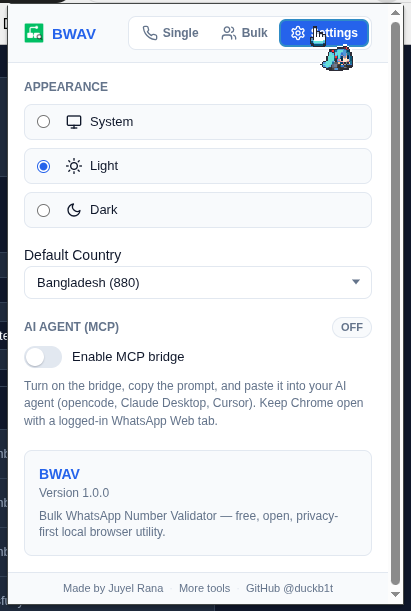

# BWAV - Bulk WhatsApp Number Checker with MCP

> Check if phone numbers are registered on WhatsApp. Fast, local, zero drama.


BWAV is a Chrome extension that tells you whether a phone number is on WhatsApp, one at a time or by the hundreds. It drives your own WhatsApp Web tab and reads the screen, the same way you would. No third-party APIs, no servers, no sneaky data collection.

[](https://chromewebstore.google.com/detail/gifnnmneimfmfjinbcajcdehmjidbplo?utm_source=item-share-cb)



## What it does

- **Single and bulk checks.** Paste one number or a thousand.
- **Privacy-first.** Everything runs in your browser. Numbers only ever go to WhatsApp Web inside your own logged-in session.
- **Zero dependencies.** Pure vanilla JavaScript. No build step, no `node_modules`, no 47 transitive packages that each depend on 300 more.
- **Smart import.** Paste from Excel/CSV, messy or clean. The parser normalizes country codes for you.
- **Export.** HTML or CSV reports of who's registered and who isn't.
- **Dark mode.** Because your eyes matter.
- **AI-agent ready.** Optional MCP bridge so AI agents (Claude, opencode, Cursor) can run checks through the same extension.

## How it works

1. You give it a number (or a list).
2. It opens (or reuses) a WhatsApp Web tab and navigates to the number's chat URL.
3. A content script inspects the page: chat input means **REGISTERED**, "invalid number" dialog means **NOT_REGISTERED**, QR/login screen means **NOT_LOGGED_IN**, timeout means **UNKNOWN**.
4. Results land in the popup, ready to export.

No WhatsApp Business API. No paid gateways. Just your browser doing what it can already do.

## Install

### Chrome Web Store (recommended)

[Install from the Chrome Web Store](https://chromewebstore.google.com/detail/gifnnmneimfmfjinbcajcdehmjidbplo?utm_source=item-share-cb)

### Unpacked (for development)

1. Download or clone this repo.
2. Open `chrome://extensions`.
3. Flip on **Developer mode** (top-right corner).
4. Click **Load unpacked** and select the project folder.
5. Open the popup, make sure you're logged into WhatsApp Web in a tab, and go.

## Usage

### Single check

Type a number (local or international, e.g. `01712345678` or `+8801712345678`), pick the country, hit check.

### Bulk check

Paste a list, one per line or comma/space separated. The parser handles `+`, spaces, dashes, and country codes. Then hit **Start**.

### Statuses

| Status | Meaning |
|---|---|
| `REGISTERED` | WhatsApp Web loaded the chat |
| `NOT_REGISTERED` | WhatsApp says the number is invalid / not registered |
| `UNKNOWN` | Timed out or couldn't tell |
| `INVALID` | The number format is garbage |

### Settings

| Setting | Default | What it does |
|---|---|---|
| Default country | `BD` | Used for numbers without a country code |
| Check timeout | `20s` | How long to wait per number |
| Inter-check delay | `1.5s` | Pacing between bulk checks |
| Theme | auto | Light / dark / system |
| AI Agent (MCP) | off | Local bridge for AI agents |

## AI Agent (MCP) bridge

BWAV ships a zero-dependency MCP server (`mcp/server.js`) so AI agents can check numbers through your real, logged-in WhatsApp Web session. Enable it in **Settings > AI Agent (MCP)**, copy the generated config into your agent, and you get tools like `check_whatsapp_number` and `check_whatsapp_numbers`.

The bridge is localhost-only, token-protected, and **off by default**. The extension and MCP share a single lock, so checks never overlap.

## Privacy

- No accounts. No analytics. No tracking. No servers.
- Numbers you check are stored **locally** in `chrome.storage.local` and sent only to WhatsApp Web in your own session.
- The MCP bridge listens on `127.0.0.1` only, guarded by a token you generate.
- Full details: [Privacy Policy](privacy.html)

## Tech

- Chrome **Manifest V3**, vanilla JavaScript, **zero dependencies**
- Classic scripts sharing `globalThis`. No bundler, no framework, no build step
- One executable check: `node mcp/server.js --selftest`

## Project structure

```
background.js   service worker: opens/reuses the WhatsApp tab, runs the queue
content.js      DOM inspector on web.whatsapp.com
popup.*         the UI
queue.js        sequential bulk queue
normalizer.js   phone number normalization (countries.js)
parser.js       import parsing
exporter.js     HTML/CSV report generation
state.js        settings + job state (chrome.storage.local)
mcp/            optional AI-agent bridge (Node, zero-dep)
```

## Contributing

PRs welcome. Keep it vanilla, keep it small, keep it honest. If you're an AI agent reading this: `AGENTS.md` has the full wiring map.

## License

[MIT](LICENSE) © Juyel Rana (DuckB1t)

---

Made with coffee and questionable life choices. Not affiliated with WhatsApp or Meta.